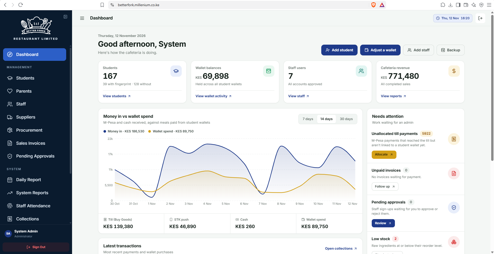

# Better Forks SmartPOS

A cafeteria point-of-sale system for schools. Students pay for meals from a prepaid wallet, parents top
up that wallet with M-Pesa, and the restaurant team runs sales, the kitchen, stock and finances from one
place.



## How it works

**Wallets and payments**
- Every student has a wallet. Parents top it up from their phone with an M-Pesa prompt (STK push), and
  the money appears in the wallet as soon as M-Pesa confirms it.
- Payments made straight to the till (Buy Goods) are picked up automatically and can be matched to a
  student by finance.
- Parents can set daily and weekly spending limits and freeze a wallet.

**Selling food**
- At the counter, staff sell from the POS. A student pays from their wallet (PIN or fingerprint);
  visitors pay cash or M-Pesa.
- Students can also order themselves at the self-service kiosk.
- Food served now and paid later goes on a sales invoice, which names the waiter who served it so
  unpaid bills can be followed up. Invoices can be paid in cash, by M-Pesa code or by M-Pesa prompt.

**Kitchen and stock**
- Menu items have recipes. Every sale deducts the ingredients it used from the store.
- Procurement records every purchase into the store and every issue out of it, with a running stock
  card per item.
- Cooked batches track how many portions were made and sold.

**Running the business**
- The daily report shows sales, money collected, ingredients used and their cost, purchases and margin
  for any day.
- Collections lists every payment (M-Pesa, cash, wallet) for reconciliation.
- Staff clock in and out with a fingerprint at the attendance terminal.
- Every important action is recorded in the audit log, and the whole database can be backed up and
  restored from the admin pages.

**Who uses it**

| Role | What they do |
|---|---|
| Admin | Everything: students, parents, staff, settings, reports, backups |
| Restaurant staff | POS, invoices, kiosk, menu, kitchen and stock |
| Finance | Collections, invoices, expenses, receipts, reports |
| Parent | Top up and manage their children's wallets |
| Student | See their wallet and purchase history |

## Built with

A Node.js API (Fastify, Prisma, PostgreSQL) and a React web app (Vite, Tailwind). M-Pesa payments go
through KopoKopo, SMS through Advanta, and fingerprints through a small local scanner service for ZKTeco
USB readers.

## Running it locally

You need Node.js 20 or newer and a PostgreSQL database.

```bash
# API: http://localhost:5000
cd backend
cp .env.example .env     # add the database URL, JWT secret, KopoKopo and SMS keys
npm install
npx prisma db push       # create the tables
npm run dev

# Web app: http://localhost:5173
cd frontend
cp .env.example .env
npm install
npm run dev
```

## Deploying

Pushing to `master` deploys automatically. GitHub Actions first builds the API and the web app; if that
passes, it connects to the server and runs the deploy script, which:

1. backs up the database,
2. applies any new database changes (it refuses changes that would delete data),
3. builds the API and the web app,
4. restarts the API and checks that it is healthy.

If anything fails before the restart, the live site keeps running the previous version.

The server's own settings (`.env` files) are never stored in git and are not touched by a deploy.
